# Minecraft Achievement Creator 🦄

- Quickly create custom Minecraft achievements for yourself. ✨
- Choose the one you like among more than 100 icons. 💯

## Important Note 🙀

This package uses [canvas](https://www.npmjs.com/package/canvas). Please read canvas install instructions first.

## Usage ✅

```js
const { ICONS, AchievementCreator } = require("mc-achievements");
// OR
import { ICONS, AchievementCreator } from "mc-achievements";

const buffer = AchievementCreator.create({
	icon: ICONS.ironLeggings,
	title: "This is title!",
	content: "This is content",
});
```

Output:


## Contributing / Issues 🐛

- Feel free to open pull requests or issues 🙀

## Icons 💡

<!-- markdownlint-disable MD033 -->

- Use `ICONS.icon_name` to access icons (eg. `ICONS.apple`)
- 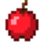 apple: "apple.png"
- 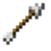 arrow: "arrow.png"
- 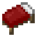 bed: "bed.png"
- 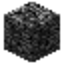 bedrock: "bedrock.png"
- 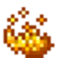 blazePowder: "blaze_powder.png"
- 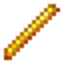 blazeRod: "blaze_rod.png"
- 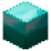 blockOfDiamond: "block_of_diamond.png"
- 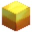 blockOfGold: "block_of_gold.png"
- 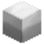 blockOfIron: "block_of_iron.png"
- 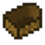 boat: "boat.png"
- 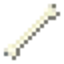 bone: "bone.png"
- 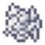 bonemeal: "bonemeal.png"
- 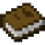 book: "book.png"
- 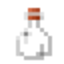 bottle: "bottle.png"
- 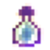 bottleOfEnchanting: "bottle_of_enchanting.png"
- 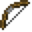 bow: "bow.png"
- 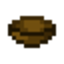 bowl: "bowl.png"
- 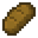 bread: "bread.png"
- 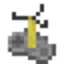 brewingStand: "brewing_stand.png"
- 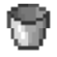 bucket: "bucket.png"
- 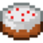 cake: "cake.png"
- 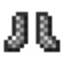 chainmailBoots: "chainmail_boots.png"
- 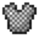 chainmailChestplate: "chainmail_chestplate.png"
- 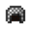 chainmailHelmet: "chainmail_helmet.png"
- 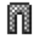 chainmailLeggings: "chainmail_leggings.png"
-  charcoal: "charcoal.png"
- 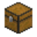 chest: "chest.png"
- 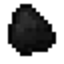 coal: "coal.png"
- 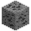 coalOre: "coal_ore.png"
- 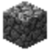 cobblestone: "cobblestone.png"
- 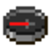 compass: "compass.png"
- 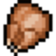 cookedChicken: "cooked_chicken.png"
- 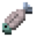 cookedFish: "cooked_fish.png"
- 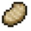 cookedPorkchop: "cooked_porkchop.png"
- 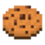 cookie: "cookie.png"
- 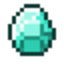 diamond: "diamond.png"
- 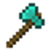 diamondAxe: "diamond_axe.png"
- 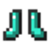 diamondBoots: "diamond_boots.png"
- 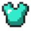 diamondChestplate: "diamond_chestplate.png"
- 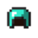 diamondHelmet: "diamond_helmet.png"
- 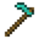 diamondHoe: "diamond_hoe.png"
-  diamondLeggings: "diamond_leggings.png"
- 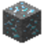 diamondOre: "diamond_ore.png"
- 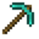 diamondPickaxe: "diamond_pickaxe.png"
- 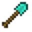 diamondShovel: "diamond_shovel.png"
- 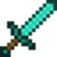 diamondSword: "diamond_sword.png"
- 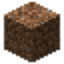 dirt: "dirt.png"
- 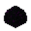 dragonEgg: "dragon_egg.png"
- 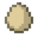 egg: "egg.png"
- 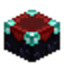 enchantmentTable: "enchantment_table.png"
- 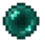 enderPearl: "ender_pearl.png"
- 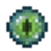 eyeOfEnder: "eye_of_ender.png"
-  feather: "feather.png"
-  fence: "fence.png"
-  fenceGate: "fence_gate.png"
-  flint: "flint.png"
-  flintAndSteel: "flint_and_steel.png"
-  furnance: "furnance.png"
-  glowstoneDust: "glowstone_dust.png"
-  goldApple: "gold_apple.png"
-  goldAxe: "gold_axe.png"
-  goldBoots: "gold_boots.png"
-  goldChestplate: "gold_chestplate.png"
-  goldHelmet: "gold_helmet.png"
-  goldHoe: "gold_hoe.png"
-  goldIngot: "gold_ingot.png"
-  goldLeggings: "gold_leggings.png"
-  goldNugget: "gold_nugget.png"
-  goldOre: "gold_ore.png"
-  goldPickaxe: "gold_pickaxe.png"
-  goldShovel: "gold_shovel.png"
-  goldSword: "gold_sword.png"
-  grass: "grass.png"
-  ironAxe: "iron_axe.png"
-  ironBoots: "iron_boots.png"
-  ironChestplate: "iron_chestplate.png"
-  ironHelmet: "iron_helmet.png"
-  ironHoe: "iron_hoe.png"
-  ironIngot: "iron_ingot.png"
-  ironLeggings: "iron_leggings.png"
-  ironOre: "iron_ore.png"
-  ironPickaxe: "iron_pickaxe.png"
-  ironShovel: "iron_shovel.png"
-  ironSword: "iron_sword.png"
-  ladder: "ladder.png"
-  lapisLazuli: "lapis_lazuli.png"
-  lavaBucket: "lava_bucket.png"
-  leather: "leather.png"
-  leatherBoots: "leather_boots.png"
-  leatherChestplate: "leather_chestplate.png"
-  leatherHelmet: "leather_helmet.png"
-  leatherLeggings: "leather_leggings.png"
-  map: "map.png"
-  melonSlice: "melon_slice.png"
-  milkBucket: "milk_bucket.png"
-  minecart: "minecart.png"
-  musicDisk: "music_disk.png"
-  obdisian: "obdisian.png"
-  paper: "paper.png"
-  piston: "piston.png"
-  potion: "potion.png"
-  pumpkin: "pumpkin.png"
-  rails: "rails.png"
-  rawBeef: "raw_beef.png"
-  rawChicken: "raw_chicken.png"
-  rawFish: "raw_fish.png"
-  rawPorkchop: "raw_porkchop.png"
-  redstoneDust: "redstone_dust.png"
-  redstoneOre: "redstone_ore.png"
-  redstoneRepeater: "redstone_repeater.png"
-  redstoneTorch: "redstone_torch.png"
-  redstoneWire: "redstone_wire.png"
-  rottenBeef: "rotten_beef.png"
-  saddle: "saddle.png"
-  shears: "shears.png"
-  sign: "sign.png"
-  slimeball: "slimeball.png"
-  snowball: "snowball.png"
-  splashPotion: "splash_potion.png"
-  steak: "steak.png"
-  stick: "stick.png"
-  stickyPiston: "sticky_piston.png"
-  stone: "stone.png"
-  stoneAxe: "stone_axe.png"
-  stoneButton: "stone_button.png"
-  stoneHoe: "stone_hoe.png"
-  stonePickaxe: "stone_pickaxe.png"
-  stonePressurePlate: "stone_pressure_plate.png"
-  stoneShovel: "stone_shovel.png"
-  stoneSword: "stone_sword.png"
-  string: "string.png"
-  waterBottle: "water_bottle.png"
-  waterBucket: "water_bucket.png"
